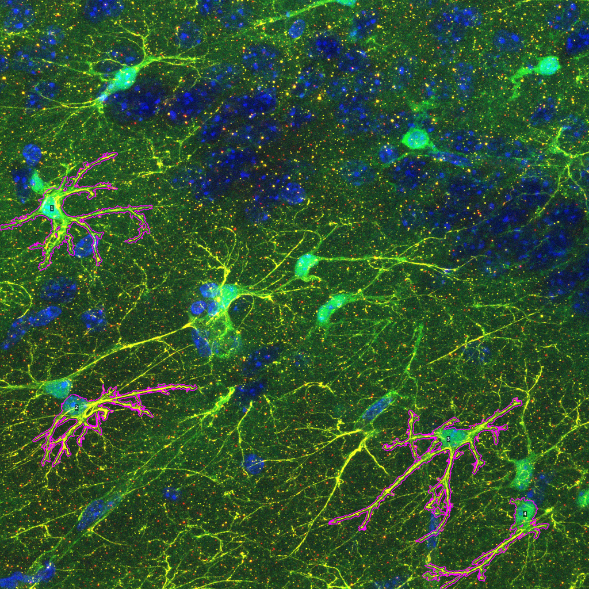
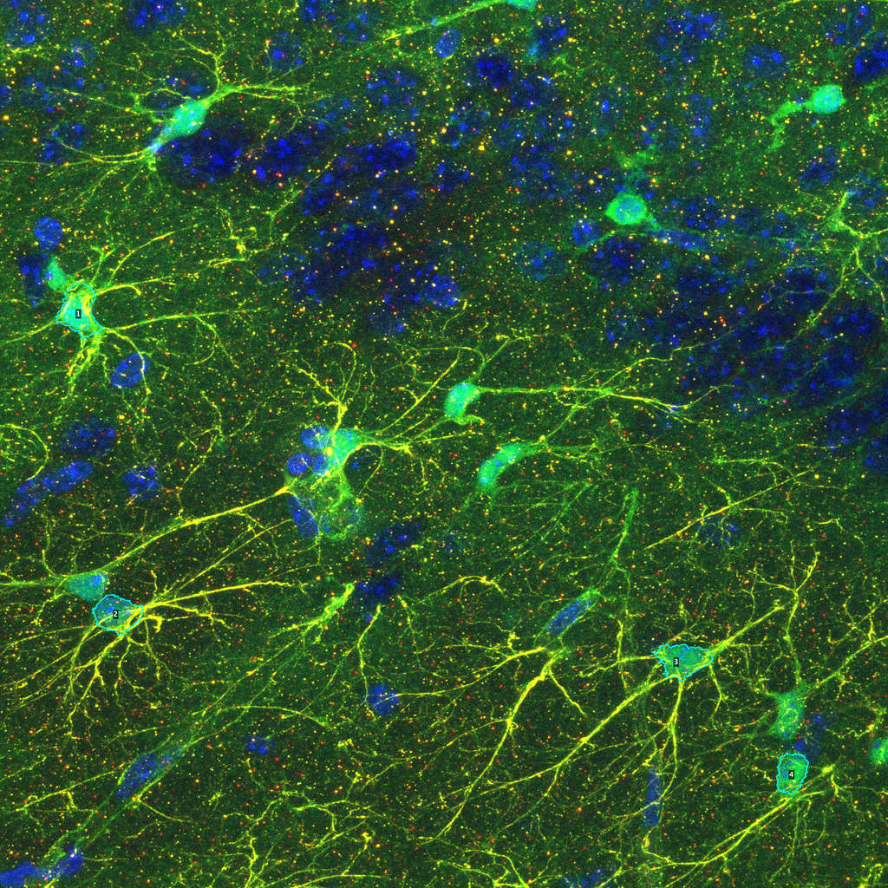
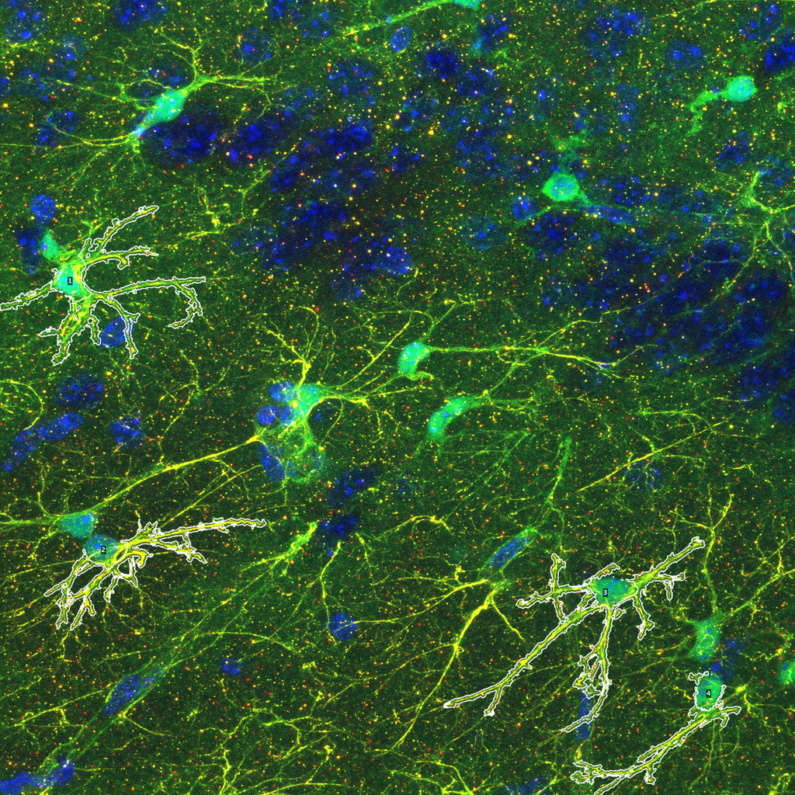

# 分析方法与测量范围

[English](methods.en.md) · [项目说明](../README_中文.md) · [使用指南](guide.zh.md)

Project Leap 2D 将开源分割模型与原创的细胞框选方法结合，通过细胞核与结构信号的关联描绘星形胶质细胞区域。程序利用带物理标定的 Z-stack 选择分析深度、识别细胞，再在所得二维区域内测量一个目标通道。本文解释模块 **v1.1.1** 的区域定义和测量范围。软件版本变化见[版本记录](../CHANGELOG.md)。

## 输入数据与通道作用

桌面导入器接受具有明确 Z、Y、X 轴及可选 C、T 轴的 TIFF，每个 TIFF 页必须是完整的单个标量 YX 平面。支持 `uint8`、`uint16` 和 `float32`，写入时不转换像素值。每个像素必须只有一个标量样本，支持的光度解释为 MINISBLACK 和 PALETTE。显微镜原生采集文件需先导出为带标定的 TIFF；合并后的 RGB 图像不受支持。

程序必须能从受支持的 OME、ImageJ／SCIFIO 或 TIFF 标定字段读取 X、Y、Z 三轴的正物理间距，并检查轴、页面、数据类型和标定。文件包含多个图像组或时间点时，用户需明确选择，每次运行只处理所选对象。OME 通道名称唯一且精确匹配时可预填角色，仍由用户确认。

分析需要一个 DAPI 通道、eGFP／GFAP 中至少一个通道，以及 KCNN1、KCNN2、KCNN3、KCNJ10 中的一个待测通道。每种角色对应独立源通道。导入器以只读方式访问原始 TIFF，在独立任务目录中生成带标定的 ZYX 工作 TIFF，保留所选像素及数据类型；引擎随后检查各通道几何尺寸和标定是否一致。

DAPI 提供细胞核证据，eGFP 和／或 GFAP 提供细胞结构证据，自动 ROI 和所选 Z 范围由这些通道决定。待测通道提供荧光测量值；其技术质量检查可能使任务停止，但不参与自动 ROI 定义或分析深度选择。

## 选择深度与构建细胞区域

| 选定的结构通道 | 分析路径及年龄配置 |
|---|---|
| eGFP，可同时含 GFAP | eGFP 路径比较五个 Z 窗口，每个窗口含 18 个候选配置。“自动”依据形态选择 Mature 或 Neonatal 处理配置，用户明确指定的类别优先。 |
| GFAP，不含 eGFP | GFAP-only 路径依据 DAPI 和 GFAP 分析，仅支持成熟星形胶质细胞。“自动”使用成熟配置，Neonatal 会被拒绝。 |

### eGFP 路径

程序从 Z-stack 两端分别排除至少 **5.0 µm**，在剩余深度中设置**五个**等距窗口。目标窗口宽度为 **9.5 µm**：将 `9.5 / Z 层间距` 四舍五入为层间隔数，恰好半个间隔时向上取整，再包括两端平面。因此实际宽度随采集时的 Z 间距而变化。两端排除范围则向上取整为整层。若容纳不下五个不同的起始位置，程序以 `z_step_limit` 停止。

每个窗口中，Morphology Baseline、Structural Refinement 和 Distributional Threshold 三类各六个配置生成整细胞候选区域。18 个候选共享投影、Cellpose-SAM 分割和预先计算的结构特征。程序先选出窗口内的最佳候选，再根据细胞核关联与轴向保留、整细胞质量、中心对应及光学证据比较五个位置。待测通道在位置评分中的权重为零。最终位置最高得分完全并列时，以 `z_selection_ambiguous` 停止。

可分析细胞要求一个轴向 DAPI 细胞核与一个整细胞连通区域双向唯一对应。轴向核证据来自逐层归一化的 DAPI P85 曲线，P85 指核区域内强度的第 85 百分位数。这些深度信息用于判断所选范围内的细胞身份。

最终窗口和初始整细胞区域确定后，程序应用年龄配置，控制后续处理。“自动”依据形态选择处理配置，不用于确定动物的真实年龄。eGFP-only 年龄校准来自**两个已知 Mature 和三个 P3 Neonatal 参考样本**。

### GFAP-only 路径

程序依据 GFAP 证据选择连续的活跃 Z 范围，由随附的 InstanSeg CPU TorchScript 模型生成 DAPI 核候选，再跨层连接细胞核、检查其与 GFAP 结构的关联、确定互斥的细胞归属，构建整细胞、胞体和突起。InstanSeg 负责提供核候选，后续分析负责构建和验证细胞区域。区域定义完成后才载入待测通道投影。五窗口、90 候选比较仅用于 eGFP 路径。

## 在 Fiji 中审核区域

Whole Cell 表示保留的完整细胞区域，Soma 表示其中的胞体，Processes 是整细胞扣除胞体后的部分。三套标签共用细胞身份，并满足：

```text
Whole Cell = Soma ∪ Processes
Soma ∩ Processes = ∅
Processes = Whole Cell − Soma
```

<!-- leap-media:start compartment-overlays -->
<table>
  <tr><th>Whole Cell</th><th>Soma</th><th>Processes</th></tr>
  <tr>
    <td><a href="images/whole-cell-overlay.png"></a></td>
    <td><a href="images/soma-overlay.png"></a></td>
    <td><a href="images/processes-overlay.png"></a></td>
  </tr>
</table>
<p><em>这三张叠加图显示同一视野的整细胞、胞体和突起区域。</em></p>
<!-- leap-media:end compartment-overlays -->

Fiji 初始对话框提供 **Measure Now** 和 **Review ROIs**：前者直接测量自动生成的区域，后者进入人工审核流程。审核后，点击 **Finish Review and Measure** 测量最终区域。`Manual_Review_Used` 记录是否进入审核流程，**Review Audit** 单独记录已应用和已撤销的编辑，供读者区分直接测量与人工审核后的测量结果。

Fiji 将区域分别叠加在结构合成图和目标通道原始灰度投影上。用户检查拟定边界，按需使用联动的 Delete、Merge、Split、Enlarge 或 Trim Processes。编辑会同步更新三类区域。Split 和 Enlarge 依据局部证据计算，可拒绝依据不足的修改；Merge 要求所选胞体边界能以不超过 **1.0 µm** 的相邻间距连成一组；Trim 保留胞体，并检查是否使保留的突起产生新的断连。具体控件及操作条件见[使用指南](guide.zh.md)。

## 测量荧光与保存结果

Fiji 对所选 Z 范围内的目标通道生成**二维最大强度投影**：每个 XY 位置保留该范围内最大的源像素强度，最终 ROI 决定参与测量的投影像素。目标强度保留原始灰度尺度及其中的背景信号，**不做背景扣除或强度归一化**。合成图颜色和显示对比度仅用于观察；结构通道为构建区域所做的图像处理，与目标强度测量分开。

工作簿的 Whole Cell、Soma 和 Processes 工作表记录面积、均值、中位数、最小值、最大值、积分密度和原始积分密度，同时保留目标通道、投影、Z 边界、年龄配置和审核记录。面积描述选定二维投影中的区域大小，强度统计描述该区域内的投影像素。Z-stack 提供判断细胞身份和选择区域的证据，输出的面积与强度统计仍以二维区域为单位，不表示细胞的三维体积。

保存前，程序检查细胞身份同步、三类区域的分割关系、Fiji 测量记录、叠加图尺寸和工作簿结构，再一起保存三幅 PNG 叠加图、TXT 报告、XLSX 工作簿及 `IHC_2D_ROI_Archive.zip`。归档包含最终三类标签 TIFF、ImageJ 原生 ROI、细胞编号的对应关系、标定、所选 Z 范围和投影，以及所用软件与运行环境的记录。导出器保留已完成的 ROI，并核对其与 Fiji 测量的对应关系。解压归档后可以查看或提取这些区域；当前软件没有一键重新打开已结束荧光任务继续编辑的入口。

将流程用于其他年龄、组织、染色方案、显微镜或实验室条件时，应采用适合目标实验的已知年龄参考样本，并审核细胞边界，以判断所选区域是否适用于该实验。比较输出的原始强度时，还需依据实验的采集设置和取样设计确定比较范围。

## 源码位置

- [深度窗口构建](../engine/project_leap_2d/images/image_processing.py)、[eGFP 流程](../engine/project_leap_2d/analysis_controller.py)及[候选选择](../engine/project_leap_2d/segmentation/candidate_selection.py)。
- [GFAP-only 流程](../engine/project_leap_2d/analysis_modes/gfap_only/gfap_only_pipeline.py)及[细胞归属与区域构建](../engine/project_leap_2d/analysis_modes/gfap_only/gfap_only_analysis.py)。
- [Fiji 审核与测量](../engine/project_leap_2d/fiji_review/resources/astrocyte_roi_reviewer.groovy)、[工作簿输出](../engine/project_leap_2d/reporting/excel_results.py)、[最终 ROI 归档](../engine/project_leap_2d/final_roi_archive.py)及[桌面适配](../engine/project_leap_2d/desktop_adapter.py)。
- TIFF 导入、通道映射、组件管理和桌面界面位于 [Project Leap 主仓库](https://github.com/DingchengWang/Project-Leap)。第三方来源和许可证见 [THIRD_PARTY_NOTICES.md](../THIRD_PARTY_NOTICES.md)。
